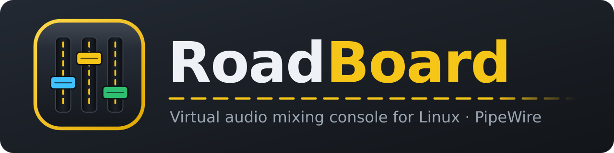
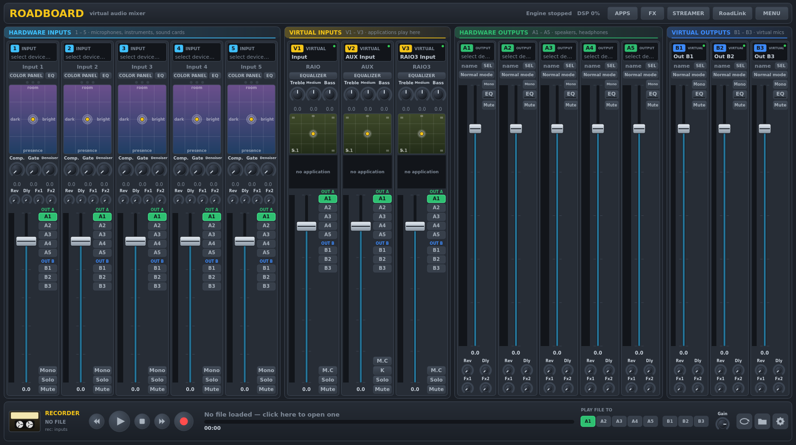
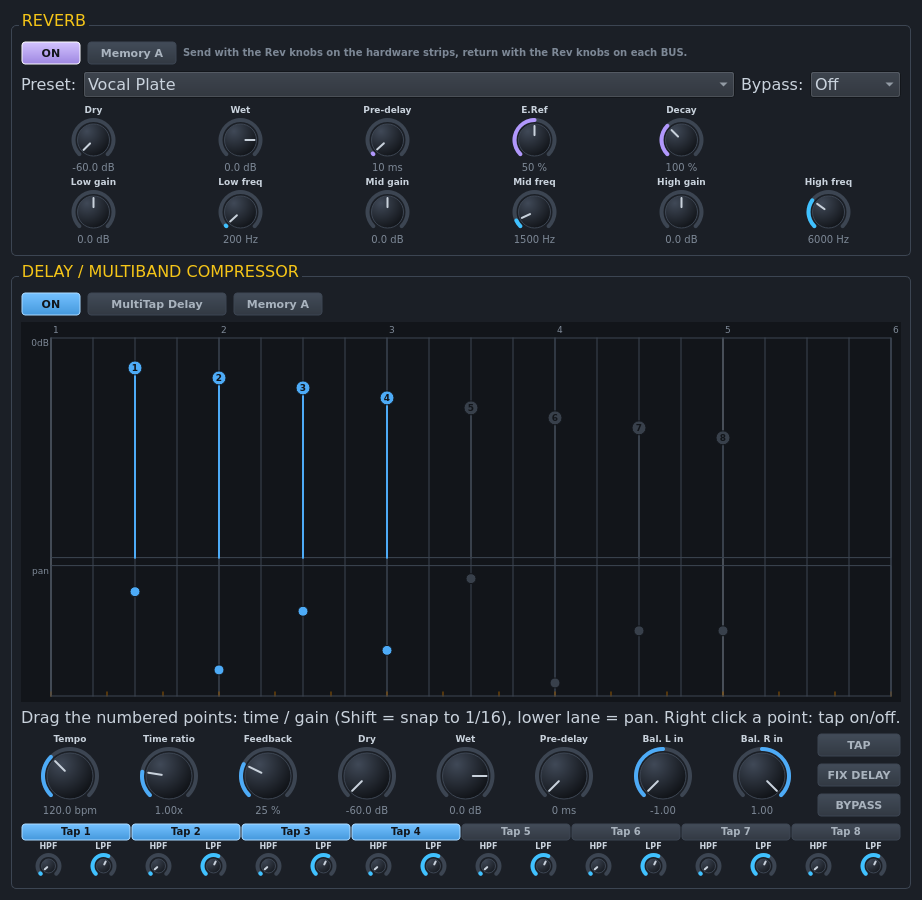
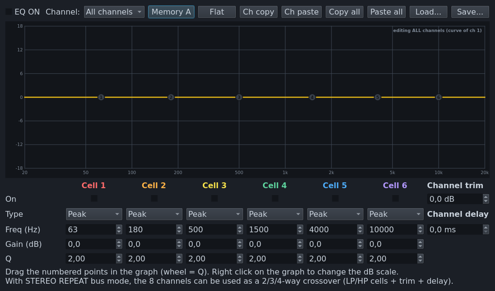

<p align="center">
  
</p>

<p align="center">
  <b>An 8 × 8 virtual audio mixing console for Linux, built on PipeWire.</b><br>
  Mix microphones, applications and sound cards, send every source to any output,
  add effects, record, stream audio over the network and control everything from scripts, MIDI or macro buttons.
</p>

<p align="center">
  
  
  
  
</p>



## Contents

- [Why RoadBoard](#why-roadboard)
- [Features](#features)
- [Virtual devices](#virtual-devices)
- [Requirements](#requirements)
- [Build and install](#build-and-install)
- [Getting started](#getting-started)
- [Remote control and scripting](#remote-control-and-scripting)
- [Screenshots](#screenshots)
- [Configuration files](#configuration-files)
- [Notes and limitations](#notes-and-limitations)

## Why RoadBoard

Linux has excellent low-level audio plumbing (PipeWire), but no all-in-one *mixing console* that lets you:

- talk on Discord with a compressed, noise-free microphone;
- play music and a game at different levels in your headphones;
- send only your voice and the game to OBS;

…all without touching a patch bay. RoadBoard is that console. It creates its own virtual audio devices, mixes everything in a single real-time DSP engine and gives you a clear, colour-coded interface:

| Colour | Group | What it is |
|---|---|---|
| 🔵 cyan | **Hardware inputs 1–5** | microphones, instruments, sound cards |
| 🟡 yellow | **Virtual inputs V1–V3** | where applications play |
| 🟢 green | **Hardware outputs A1–A5** | speakers, headphones, sound cards |
| 🔷 blue | **Virtual outputs B1–B3** | virtual microphones for other apps |

Every input strip has **OUT A** (green) and **OUT B** (blue) buttons that decide where it goes.

## Features

### Inputs
- **5 hardware strips**: any capture device, or the *monitor* of an output.
  - **ROADPAN** 2D panel with three pages: *Color Panel* (voice colour + small room), *Modulation* (chorus, flanger, vibrato) and *3D Panel* (binaural positioning).
  - **6-band parametric EQ** (stereo, A/B memories).
  - **Compressor** with automatic make-up and **Gate**, each with a detail view: threshold, ratio, attack, release, knee, band-pass side-chain, transfer graph, undo.
  - **Denoiser** (spectral noise-floor remover) and **Voice Modeler** (pitch ±12 semitones, three formant bands, 8 presets).
  - **FX sends**: Reverb, Delay and two external FX, each pre or post fader.
  - Brick-wall limiter (zero latency, or 5 ms look-ahead), Mono, Solo, Mute.
- **3 virtual strips**: 3-band EQ, 5.1 pan pot with 15 channel modes, centre-channel mute, karaoke voice removal (4 algorithms).
  - The applications connected to the strip are shown with their own volume and mute.

### Mixing
- Full **8 × 8 matrix**: every strip has its own level in every bus.
  - Press **SEL** on a bus and all faders show that bus's sub-mix.
  - Right-click the A/B buttons to see every sub-mix at once.
  - Absolute or relative fader mode.
- **Monitor on SEL**: listen to any bus on your monitoring output.

### Outputs (8 buses, up to 8 channels each)
- **14 bus modes**: mix-down A/B, stereo repeat, composite, TV up-mix, 2.1 / 4.1 / 6.1 up-mix, left / right / centre / LFE / rear only.
- **6-cell parametric EQ on all 8 channels**, with trim and delay per channel and A/B memories. It can also act as a crossover for active speakers.
- Mono / stereo reverse, mute, limiter, output delay.
- Reverb / Delay / FX returns.

### Effects
- **Reverb**: 12 presets, pre-delay, early reflections, decay, 3-band EQ, A/B memories.
- **MultiTap Delay**: 8 stereo taps on a musical timeline, TAP tempo, feedback, per-tap filters and pan.
- **5-band multiband compressor / limiter**, as an alternative to the delay.
- **External FX ports**: plug any JACK / PipeWire effect host (e.g. Carla) into the console.

### Tools
- **Application Mixer**: for every application choose with one click *Virtual Input 1 / 2 / 3*, any other device, its volume and mute. The choice is remembered.
  - The *Devices* page controls every input and output of the system.
- **Recorder / player** (transport bar):
  - records WAV, BWF, AIFF, FLAC, OGG or MP3, from the inputs or from any bus;
  - multitrack files, pre-record buffer, stop after a set duration;
  - plays WAV, FLAC, OGG and MP3, plus M4A, MP4, MOV, AVI and WMA through ffmpeg, into any bus.
- **RoadLink** network audio:
  - 8 incoming and 8 outgoing streams over UDP, 16/24-bit or float, 11–96 kHz;
  - automatic drift compensation, plus a text command stream.
- **MIDI**: learn mode, push-to-talk, F/FF feedback for motorised faders and LED buttons.
- **Macro Buttons**: push or toggle buttons running scripts, triggered by mouse, keyboard, MIDI, audio level (auto-ducking) or recorder events.
- **Streamer View**, **64 preset scenes**, system tray, autostart, GUI lock.

## Virtual devices

RoadBoard creates these PipeWire devices. They work with every PulseAudio, PipeWire, ALSA and JACK application.

| Device | Type | Connected to |
|---|---|---|
| **RoadBoard Input** | playback | virtual input V1 |
| **RoadBoard AUX Input** | playback | virtual input V2 |
| **RoadBoard RAIO3 Input** | playback | virtual input V3 |
| **RoadBoard Out B1 / B2 / B3** | recording | buses B1 / B2 / B3 |
| **RoadBoard In 1 … In 5** | playback | hardware strips 1–5 (*RAIO extension*) |
| **RoadBoard Out A1 … A5** | recording | buses A1–A5 (*RAIO extension*) |
| RoadBoard FX1 / FX2 Send & Return | recording / playback | external FX (optional) |

With the RAIO extension **every input and every output of the console is also a device**. For example, record exactly what you hear on A1 with OBS, or send a program straight into hardware strip 3.

## Requirements

- Linux with **PipeWire** (≥ 0.3.60) and WirePlumber. This is the default on Fedora, Ubuntu ≥ 22.10, Debian ≥ 12, Arch, openSUSE, Mint, Pop!_OS, Manjaro…
- Qt 6, libsndfile, libsamplerate, ALSA (for MIDI).
- Optional: `ffmpeg` for video and M4A/WMA files on the player.

| Distribution | Command |
|---|---|
| Arch / Manjaro | `sudo pacman -S --needed cmake ninja qt6-base qt6-svg pipewire wireplumber libsndfile libsamplerate alsa-lib ffmpeg` |
| Debian / Ubuntu | `sudo apt install cmake ninja-build qt6-base-dev qt6-svg-dev libpipewire-0.3-dev libsndfile1-dev libsamplerate0-dev libasound2-dev ffmpeg` |
| Fedora | `sudo dnf install cmake ninja-build qt6-qtbase-devel qt6-qtsvg pipewire-devel libsndfile-devel libsamplerate-devel alsa-lib-devel ffmpeg-free` |
| openSUSE | `sudo zypper install cmake ninja qt6-base-devel qt6-svg pipewire-devel libsndfile-devel libsamplerate-devel alsa-devel ffmpeg` |

## Build and install

```bash
git clone https://github.com/HubDevCode/RoadBoard.git
cd RoadBoard
cmake -S . -B build -G Ninja -DCMAKE_BUILD_TYPE=Release
cmake --build build
./build/roadboard                 # run from the build folder
sudo cmake --install build        # or install system-wide
```

### Packages

| Format | How |
|---|---|
| AppImage (any distribution) | `packaging/appimage/build-appimage.sh` |
| Flatpak | `flatpak-builder --user --install build-flatpak packaging/flatpak/io.github.roadboard.RoadBoard.yml` |
| Arch Linux | `cd packaging/arch && makepkg -si` |
| .deb / .rpm / .tar.gz | `cd build && cpack` |

## Getting started

1. Start RoadBoard.
2. In **Hardware outputs**, click the header of **A1** and choose your headphones or speakers.
3. In **Hardware inputs**, click the header of strip **1** and choose your microphone.
4. *Menu → System Default Devices → Playback: RoadBoard Input*. Now every application plays into V1.
5. Press **APPS** and send each application to *Virtual Input 1, 2 or 3* (e.g. music on 2, game on 3). Balance them with the V1–V3 faders.
6. In Discord, OBS or Zoom select **RoadBoard Out B1** as microphone. Light **B1** on the strips you want them to hear.

Tips: double-click any control to reset it, right-click knobs for details, use Ctrl or Shift for fine adjustments.

## Remote control and scripting

RoadBoard listens on a local socket (`$XDG_RUNTIME_DIR/roadboard.sock`). The same request language is used by the command line, Macro Buttons, MIDI and RoadLink text streams.

```bash
roadboard --cmd 'Strip(0).Mute=1; Bus(0).Gain=-6;'
roadboard --cmd 'Strip(5).FadeTo=(-20, 500);'           # fade V1 to -20 dB in 500 ms
roadboard --cmd 'Strip(0).GainLayer(5)=-10;'            # level of input 1 in the B1 mix
roadboard --cmd 'Command.RouteApp=("spotify", 2);'      # Spotify -> Virtual Input 2
roadboard --cmd 'Strip(6).AppGain=("firefox", 0.5);'    # volume of an application
roadboard --cmd 'Recorder.Load="/home/me/jingle.wav"; Recorder.B1=1;'
roadboard --get 'Strip(0).Gain'
roadboard --get 'level.bus[0]'                          # current peak levels in dBFS
```

Requests are separated by `;` or new lines. `+=` / `-=` change values relatively (`Strip(0).Mute+=1` toggles). Indices start at 0: strips 0–4 are the hardware inputs and 5–7 the virtual inputs; buses 0–4 are A1–A5 and 5–7 are B1–B3.

## Screenshots

| Special FX | Parametric EQ |
|---|---|
|  |  |

## Configuration files

Everything lives in `~/.config/roadboard/`:

| File | Content |
|---|---|
| `current.xml` | full mixer state, saved automatically |
| `presets/` | 64 preset scenes |
| `midi.map` | MIDI mapping |
| `macrobuttons.json` | macro buttons |
| `apps.ini` | remembered application routing |
| `voice_presets.json` | Voice Modeler presets |
| `options.ini` | application options |

## Notes and limitations

- **RoadLink** uses, by default, the packet format of existing network-audio apps, so RoadBoard can exchange audio with phones and other computers. A RoadBoard-only format can be selected in the RoadLink window.
- Tools that automatically move audio streams (per-application routers or equalisers) can fight with the Application Mixer. Exclude the applications you route with RoadBoard from them.
- Not implemented yet: per-application level meters, HID / gamepad triggers for macro buttons, screen sharing over the network.
